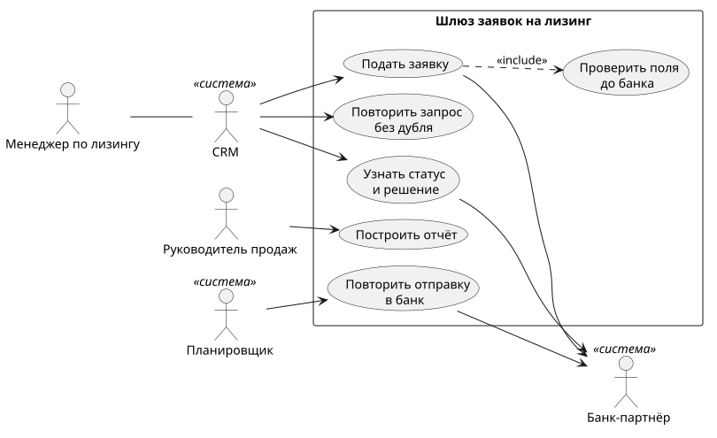
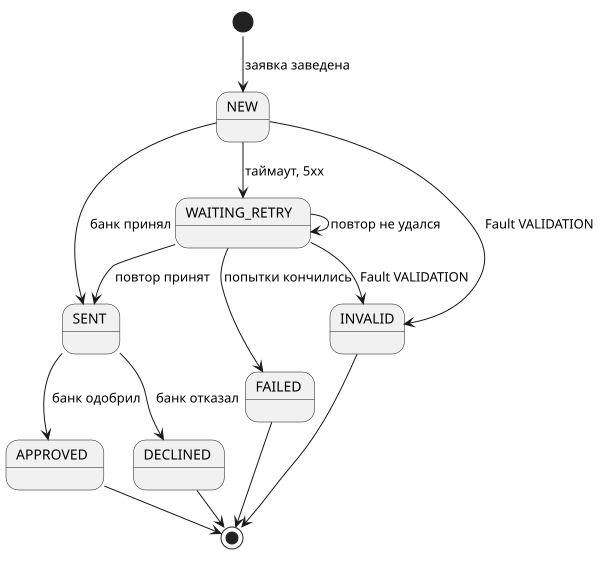
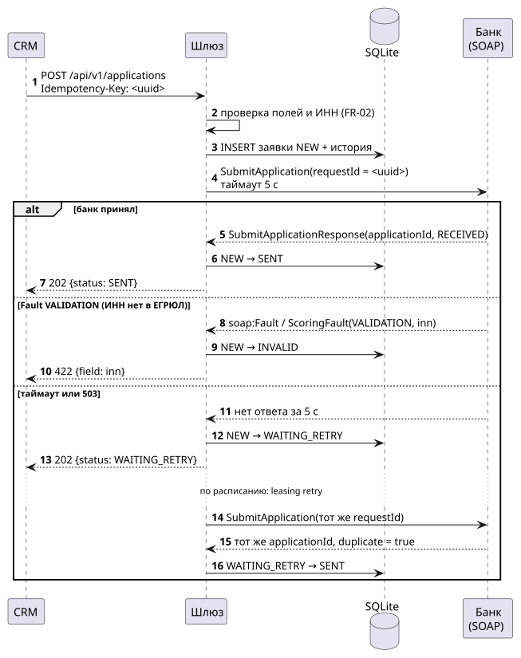
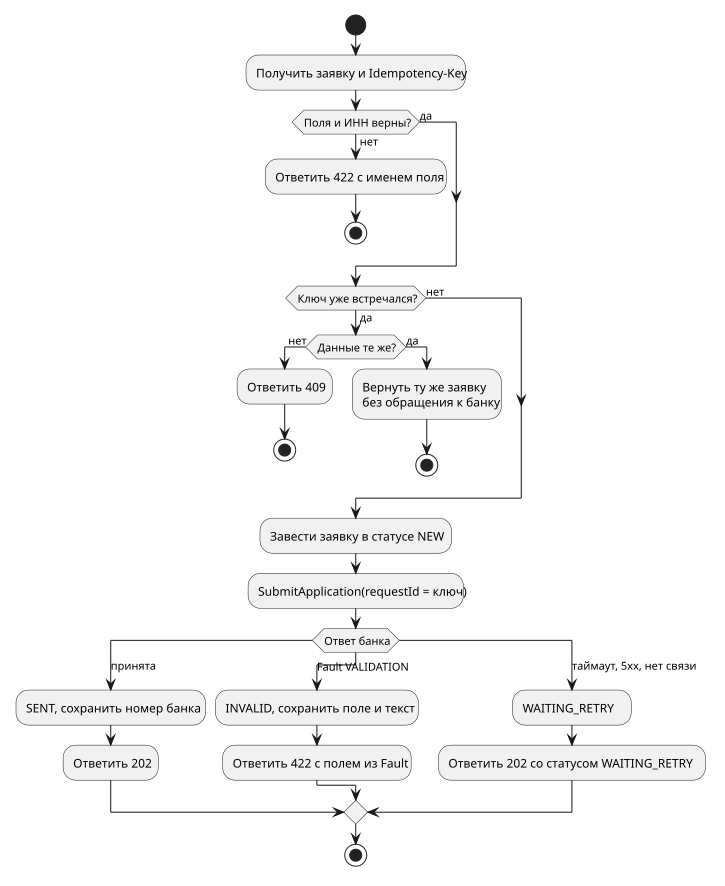
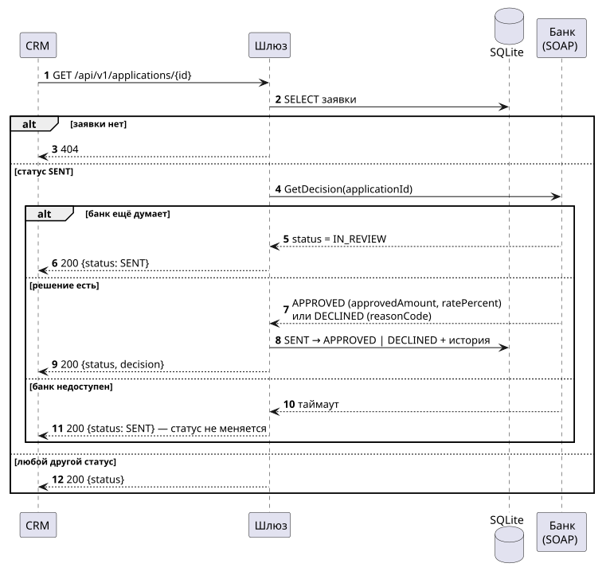
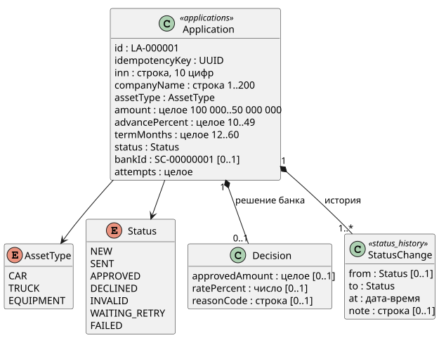
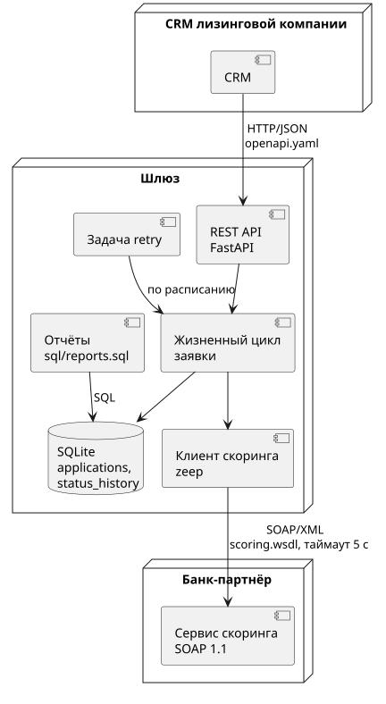
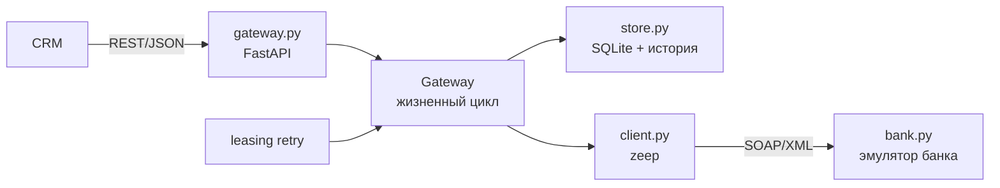

# leasing-scoring — заявка на лизинг и банковский скоринг по SOAP

Проект системного аналитика: интеграция CRM лизинговой компании с SOAP-сервисом скоринга банка-партнёра.
Требования, UML-диаграммы, WSDL/XSD и OpenAPI здесь не лежат отдельно от кода, а проверяются им:

- **диаграмма состояний** сверяется с таблицей переходов в коде;
- **ограничения полей** совпадают в XSD банка, в OpenAPI шлюза и в модели;
- **каждое требование** покрыто тестами, это видно по матрице трассировки;
- **SVG диаграмм** не может отстать от исходника.

Чтобы всё это можно было запустить, сделаны эмулятор банка и сам шлюз.

**Стек:** Python 3.12 · FastAPI · zeep (SOAP-клиент) · lxml (SOAP-сервер, XSD) · SQLite · PlantUML · pytest ·
jsonschema · ruff · mypy (strict).

## Что внутри

| Артефакт | Где | Что в нём |
|---|---|---|
| Спецификация требований | [docs/srs.md](docs/srs.md) | контекст и проблема, заинтересованные стороны, границы, глоссарий, 10 функциональных и 3 нефункциональных требования с критериями приёмки, открытые вопросы, допущения о банке |
| UML | [docs/diagrams](docs/diagrams) | 7 диаграмм: варианты использования, деятельность, две последовательности, состояния, классы, компоненты |
| SOAP-контракт банка | [api/scoring.wsdl](api/scoring.wsdl), [api/scoring.xsd](api/scoring.xsd) | SOAP 1.1, document/literal, две операции, типизированный Fault |
| REST-контракт шлюза | [api/openapi.yaml](api/openapi.yaml) | два пути, ключ идемпотентности, единый формат ошибки |
| Примеры сообщений | [docs/examples](docs/examples) | XML и JSON; тесты проверяют их по схемам |
| Модель данных и отчёты | [sql/schema.sql](sql/schema.sql), [sql/reports.sql](sql/reports.sql) | заявки и история статусов; 4 отчёта для руководителя продаж |
| Матрица трассировки | [docs/traceability.md](docs/traceability.md) | требование → диаграммы → операции API → тесты; строится из артефактов |

### Диаграммы

| | |
|---|---|
|  |  |
|  |  |
|  |  |
|  | |

## Демонстрация

```text
$ leasing demo

1. Обычная заявка: банк одобряет
  POST → 202 {'id': 'LA-000001', 'status': 'SENT', 'bankId': 'SC-00000001', 'attempts': 1, 'decision': None}
  GET  → 200 {'id': 'LA-000001', 'status': 'APPROVED', … 'decision': {'approvedAmount': 2400000, 'ratePercent': 15.5, 'reasonCode': None}}

2. ИНН из стоп-листа банка: отказ
  GET  → 200 {'id': 'LA-000002', 'status': 'DECLINED', … 'reasonCode': 'STOP_LIST'}}

3. Ошибка в ИНН ловит шлюз — банк не вызывается
  POST → 422 {'error': 'validation', 'field': 'inn', 'message': 'контрольная цифра ИНН не сходится'}

4. ИНН верный, но его нет в ЕГРЮЛ — это знает только банк
  POST → 422 {'error': 'validation', 'field': 'inn', 'message': 'ИНН не найден в ЕГРЮЛ'}

5. Повтор запроса с тем же ключом — та же заявка
  тот же номер: True

6. Тот же ключ, другие данные — конфликт
  POST → 409 {'error': 'conflict', 'field': 'Idempotency-Key', …}

7. Банк на обслуживании: заявка ждёт повтора
  POST → 202 {'id': 'LA-000005', 'status': 'WAITING_RETRY', 'bankId': None, 'attempts': 1, 'decision': None}
  GET  → 200 {'id': 'LA-000005', 'status': 'APPROVED', 'bankId': 'SC-00000004', 'attempts': 2, …}

8. Банк принял заявку, но ответ опоздал на таймаут
  POST → 202 {'id': 'LA-000006', 'status': 'WAITING_RETRY', …}
  GET  → 200 {'id': 'LA-000006', 'status': 'APPROVED', 'bankId': 'SC-00000005', 'attempts': 2, …}
  заявок в банке прибавилось: 1 — дубля нет
```

Восьмой сценарий — главный повод для ключа идемпотентности. Банк уже принял заявку, но ответ не
уложился в таймаут, и шлюз считает, что отправка не удалась. Если при повторе сгенерировать новый
`requestId`, в банке окажутся две заявки на один автомобиль. Поэтому ключ, который CRM передаёт
в `Idempotency-Key`, уходит в банк как `requestId`. Банк узнаёт его и возвращает прежний номер
с `duplicate=true`.

## Как запустить

```bash
uv sync
uv run leasing demo                       # восемь сценариев выше, всё в одном процессе
uv run leasing bank --review-seconds 30   # эмулятор банка: http://127.0.0.1:8070/scoring?wsdl
uv run leasing api                        # шлюз: http://127.0.0.1:8000/docs
uv run leasing retry                      # повторить WAITING_RETRY (для планировщика)
uv run leasing report                     # SQL-отчёты по leasing.db
uv run leasing trace                      # перестроить docs/traceability.md
uv run leasing render --jar plantuml.jar  # перерисовать SVG диаграмм (нужна Java 8+)
```

Запрос к банку без шлюза — обычным curl, тело из примеров:

```bash
curl -X POST http://127.0.0.1:8070/scoring \
  -H 'Content-Type: text/xml; charset=utf-8' \
  -H 'SOAPAction: "http://example.org/scoring/v1/SubmitApplication"' \
  --data-binary @docs/examples/submit-request.xml
```

## Как устроено



| Модуль | Ответственность |
|---|---|
| `states.py` | статусы и таблица разрешённых переходов — единственный источник правды для диаграммы состояний |
| `store.py` | заявки и история в SQLite, смена статуса только по таблице переходов |
| `gateway.py` | REST, проверка полей и ИНН, отправка в банк, разбор ответа, повтор |
| `client.py` | SOAP-клиент на zeep по WSDL из репозитория: Fault превращается в понятное исключение, сетевые сбои — в «банк недоступен» |
| `bank.py`, `scoring.py` | эмулятор банка на lxml: разбор конверта, проверка по XSD, правила скоринга, Fault |
| `trace.py`, `diagrams.py`, `reports.py` | матрица трассировки, проверка SVG, SQL-отчёты |

## Почему так

**SOAP-сервер без фреймворка.** Для банка можно было взять spyne, но тогда контракт выводился бы
из кода. Здесь наоборот: WSDL и XSD написаны первыми, как у настоящего банка. Сервер на lxml
делает ровно то, что требует контракт: проверяет тело по XSD и отвечает типизированным Fault,
в котором указано поле. Клиент на zeep читает тот же WSDL. Если контракт и сервер разойдутся,
zeep в строгом режиме упадёт на разборе ответа.

**Проверка до банка и в банке.** Шлюз ловит то, что может проверить сам: диапазоны, форматы,
контрольную цифру ИНН. Ответ приходит за миллисекунды, банк не нагружается. Реестр юрлиц есть
только у банка, поэтому «ИНН не найден в ЕГРЮЛ» приходит Fault-ом. Шлюз превращает его в тот же
422 с тем же полем: для CRM нет разницы, кто нашёл ошибку.

**Недоступный банк ≠ ошибка заявки.** Таймаут, 503 и разрыв соединения переводят заявку
в `WAITING_RETRY`, а не в `INVALID`. Отказ банка по существу приходит Fault-ом, а сбой связи
означает лишь «ответа не было». Если это смешать, рабочие заявки будут теряться.

**Статус меняется только по таблице.** Попытка перевести заявку из `NEW` сразу в `APPROVED`
вызывает исключение, история при этом не меняется. Таблицу в коде и стрелки на диаграмме
состояний сверяет тест.

## Как проверялось

- `ruff format`, `ruff check` (E, F, W, I, B, UP, S — bandit, C4, SIM, PT, RUF, DTZ) и `mypy --strict` — без замечаний.
- `pytest` — 106 тестов за 6 с. Эмулятор банка в тестах работает на настоящем сокете, а шлюз
  ходит в него через zeep, как в жизни.
- **Трассировка.** У всех 13 требований есть тесты. Ссылок на несуществующие требования нет.
  Файл матрицы совпадает с тем, что строится из артефактов.
- **Три контракта.** Для каждого из шести полей заявки тест сравнивает шаблон, длину, диапазон
  и перечисление в XSD, `openapi.yaml` и JSON Schema модели шлюза. Ответы шлюза проверяются
  по схемам `openapi.yaml` через jsonschema. FastAPI не публикует путей сверх контракта.
- **Диаграммы.** PlantUML вшивает исходник в SVG. Тест расшифровывает его, сравнивает с `.puml`
  и проверяет, что на диаграммах последовательности есть каждая SOAP-операция и каждый
  REST-путь.
- **Примеры** из `docs/examples` проверяются по XSD и OpenAPI. Пример запроса принимают
  и банк, и шлюз.
- **Безопасность разбора XML.** Запрос с внешней сущностью (XXE), которая ссылается на файл,
  получает Fault, содержимого файла в ответе нет. Тело больше 64 КБ получает 413.
- **Отчёты** проверены на данных, где ответ посчитан руками. В том числе проверено, что время
  решения считается от повторной отправки, а не от первой неудачной попытки.
- **Живой прогон.** Банк и шлюз запускались отдельными процессами, запросы шли через curl:
  - WSDL отдаётся;
  - пример SOAP-запроса принят;
  - при `--review-seconds 3` заявка 3 секунды стоит в `SENT`, потом становится `APPROVED`;
  - банк остановили, отправили заявку и получили `WAITING_RETRY`; после запуска банка
    `leasing retry` перевёл её в `SENT`;
  - отчёты по получившейся `leasing.db` строятся.

### Что нашлось по ходу

- **FastAPI по умолчанию отвечает на ошибку проверки списком в своём формате и по-английски.**
  Это не совпадало с объявленным в контракте `Error {error, field, message}`. Теперь ошибку
  разбирает свой обработчик: имя поля в camelCase, как в контракте, и текст по-русски.
  CRM показывает его менеджеру без доработки.
- **PlantUML вшивает в SVG текст без строк `@startuml` и `@enduml`.** Первая версия проверки
  свежести считала устаревшими все семь картинок, теперь служебные строки при сравнении
  отбрасываются.

### Не проверялось

- Банк вымышленный, его правила — допущения из приложения А SRS. С настоящим банковским SOAP-сервисом
  шлюз не работал. WS-Security, подписи сообщений и mTLS, обычные для банков, не реализованы.
- SoapUI и Postman не использовались: SOAP проверялся через zeep, curl и тесты на сыром XML.
- Авторизации между CRM и шлюзом нет: в SRS это открытый вопрос Q1.
- SQLite выбрана для запуска на ноутбуке. Два процесса (шлюз и `retry`) с одной базой проверены
  только вручную и на малой нагрузке.
- BPMN-диаграммы нет, только UML.
- Опрос `GetDecision` при каждом `GET` — простейший вариант. При большом числе заявок банк
  получит лишнюю нагрузку. Уведомление о решении (callback) записано открытым вопросом Q2.

## Структура

```text
api/          scoring.wsdl, scoring.xsd, openapi.yaml
docs/         srs.md, traceability.md, diagrams/ (.puml + .svg), examples/
sql/          schema.sql, reports.sql
src/leasing/  bank, scoring, client, gateway, store, states, trace, diagrams, reports, cli
tests/        SOAP на сыром XML, шлюз по HTTP, контракты, документация, отчёты, юнит-тесты
```
